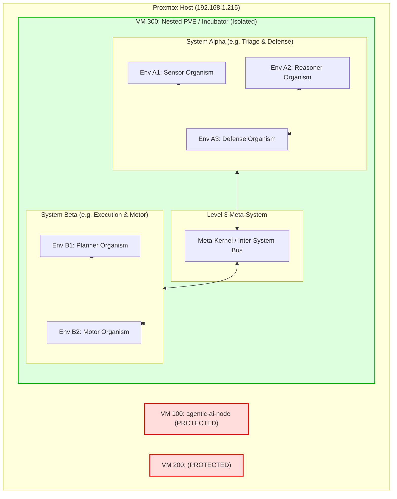

# Recursive Multi-Environment Architecture for bigBangEnv
## Nested Proxmox VE & Hierarchical Systems Blueprint

> **Core Philosophy**:  
> In `bigBangEnv`, agents are not static prompt loops—they are living cells inside an environmental membrane.  
> Just as biology builds **Molecules → Organelles → Cells → Organs → Organisms → Societies**, our computing architecture must build:  
> **Signals → Cells → Organisms (Kernels) → Systems (Colonies) → Meta-Systems (Societies)**.

---

## 1. The Isolation Guarantee & Nested Incubator Concept

To ensure `bigBangEnv` **never touches VM100, VM200, or any existing host workload**, we encapsulate the entire evolutionary tree inside a single root boundary: **The BigBang Incubator VM** (e.g. VM ID `300`).



### Why Nested Virtualization is the Ideal Fit:
1. **Zero Host Contamination**: From the physical Proxmox host's perspective, there is only **one** virtual machine (ID 300).
2. **Blast Radius Containment**: If nested environments spawn, mutate, starve, loop, or crash, the host hypervisor and neighboring VMs (100, 200) are physically oblivious.
3. **Internal Software-Defined Network (SDN)**: Nested environments communicate across an internal virtual bridge (e.g., `vmbr1` inside VM 300) with a private IP subnet (`10.99.0.0/16`). No inter-agent chatter or broadcast packets ever hit your physical home LAN.
4. **Infinite Recursive Nesting**: A nested environment can host its own sub-environments, matching the multi-level vision.

---

## 2. Platform Comparison: Nested Proxmox VE vs. Incus / LXD

We evaluate two architectures for the Incubator (VM 300):

| Dimension | Option A: Nested Proxmox VE (PVE-in-PVE) | Option B: Incus / System-Container Node (Recommended Alternative) |
|---|---|---|
| **Form Factor** | Full Proxmox VE 8.x installed inside VM 300 | Debian 12 / Ubuntu 24.04 running **Incus** inside VM 300 |
| **Management** | Full Proxmox Web GUI, PVE REST API, native clustering | Native CLI (`incus`), REST API, OpenTofu/Terraform provider |
| **Overhead per Environment** | ~100–150 MB RAM per nested LXC; ~500 MB per nested VM | ~30–50 MB RAM per system container |
| **Environment Density** | 10–20 environments on 8–16 GB RAM | **50–100+ environments** on 8–16 GB RAM |
| **Spin-up Latency** | ~5–10 seconds per container | **< 1–2 seconds** instant container boot |
| **Programmatic Spawning** | Shell scripting `pct create` or Proxmox API token | Pure declarative YAML / REST API / Go / Python SDK |
| **Best Used For** | If you want a visual Proxmox GUI for the sub-environments | If you want autonomous programmatic evolution of many environments |

> **Recommendation**:  
> Both can run inside VM 300! You can start with **Nested Proxmox VE** if you want the visual multi-pane GUI to watch the environments live, or **Incus** if you want maximum density and instant API-driven spawning.

---

## 3. The Recursive Multi-Tier Architecture

How multiple environments collectively form higher-order systems:

```
Level 0: Kernel Laws (Trust, Energy, Time, Membrane)
   ↓
Level 1: Organism Environment (A single bigBangEnv kernel with Sensory, Reflex, Motor, Defense cells)
   ↓
Level 2: Composite System / Organ (A cluster of heterogeneous Organism Environments working in concert)
   ↓
Level 3: Meta-System / Colony (Multiple Systems coordinating via an Inter-System Membrane)
   ↓
Level 4: Society (Autonomous ecosystem with decentralized discovery and resource exchange)
```

### Inter-Environment Membrane Protocol (The Synaptic Bus)
In Level 1, cells talk via Python topics inside one process:
```python
context.emit("topic", data, trust=...)
```
In Level 2 and above, environments talk via **Inter-Membrane Bridges**:
1. **Sensory Exporters**: A Motor cell in Organism A emits an action that drops an input into Organism B's sensory input drop (`/var/lib/bigbang/issues/` or an HTTP/Unix socket).
2. **Provenance Preservation**: Trust and taint carry forward across environments via cryptographic or signed tokens (`KERNEL > OWNER > OPERATOR > PEER_ORGANISM > WORLD`).
3. **Mutual Inhibition / Defense Federation**: A defense cell in System Alpha can emit an inhibition vector that temporarily holds actions across all motor cells in System Beta.

---

## 4. Host Provisioning Script for Proxmox (`192.168.1.215`)

To deploy the Incubator VM on your Proxmox server, run the dedicated script below on Proxmox:

```bash
# Provision Nested PVE VM ID 300
./proxmox-nested-pve-provision.sh
```

### VM Specifications:
- **VM ID**: `300` (Guarded: cannot be 100 or 200)
- **Name**: `bigbang-incubator`
- **CPU**: `host` (Enables Intel VMX / AMD SVM nested virtualization)
- **Cores**: 4
- **RAM**: 8192 MB (8 GB)
- **Disk**: 64 GB SSD (`local-lvm` or `local-zfs`)
- **Net 0**: `vmbr0` (WAN/LAN for management)
- **Net 1**: `vmbr1` (Private internal bridge for inter-environment communication)
